# White Noise Android UI patterns

**Google Material 3 Expressive is the design standard across the app. White Noise’s default palette is monochrome.** Use Google’s guidance for layouts, component choice, shapes, spacing, typography and font sizes, icons, interaction, and motion. Use Android’s public platform APIs for system-owned experiences. Check availability in the [app’s version catalog](../gradle/libs.versions.toml). [Google’s Material 3 guide](https://developer.android.com/develop/ui/compose/designsystems/material3) · [Compose component catalog](https://developer.android.com/develop/ui/compose/components)

This guide is for choosing a pattern, finding where White Noise uses it, and understanding what happens when someone acts. **Current app example** means the image shows an existing screen or a component fixture. It can show a useful pattern, an unresolved choice, or a defect. The scope of a product action, such as deleting a message for everyone, comes from the actual White Noise feature. Its appearance and interaction should follow the closest Google pattern.

## Find a pattern

- [Text, identity, and icons](#text-identity-and-icons)
- [Page layout, stacked content, and navigation](#page-layout-stacked-content-and-navigation)
- [Buttons, controls, and input](#buttons-controls-and-input)
- [Sheets, dialogs, menus, and other overlays](#sheets-dialogs-menus-and-other-overlays)
- [Chat lists, messages, and the timeline](#chat-lists-messages-and-the-timeline)
- [Composer, attachments, and playback](#composer-attachments-and-playback)
- [Feedback, progress, and recovery](#feedback-progress-and-recovery)
- [Account flows and Android-owned surfaces](#account-flows-and-android-owned-surfaces)
- [How to use examples in a review](#how-to-use-examples-in-a-review)

## Foundation choices

| Decision | Apply it in White Noise |
| --- | --- |
| Color and theme | Use the [theme’s semantic color roles](../app/src/main/java/dev/ipf/whitenoise/android/ui/theme/Theme.kt) for surfaces, content, outlines, and state. Keep the default neutral in light and dark. Preserve error and selection meaning, user-selected account accents, and the existing AMOLED option. Avatars, photos, stickers, and a color chooser can contain color. |
| Typography and icons | Start with the Material component’s title, headline, label, body, and supporting-text slots. Keep the role’s size, weight, line height, and the person’s font and scale settings. Use familiar Android symbols for commands, describe icon-only actions, and allow text to wrap. [Type roles](../app/src/main/java/dev/ipf/whitenoise/android/ui/theme/Type.kt) |
| Layout, alignment, and density | Use Material scaffolds, lists, grids, app bars, and window-aware layouts. Align labels with the content they describe. Use the component’s own internal padding and minimum size. Use the app’s shared relationship-based spacing for composition where Google leaves the space between components to the app. [Spacing](../app/src/main/java/dev/ipf/whitenoise/android/ui/theme/WhiteNoiseSpacing.kt) |
| Shape, containment, and elevation | Start with the component’s shape, elevation, outline, and state layers. A connected group has distinct outer and inner corners. An alert needs an inset surface and a scrim. A tooltip or menu anchors to a control. Check existing wrappers for how they implement those roles. [Grouped row shapes](../app/src/main/java/dev/ipf/whitenoise/android/ui/common/WhiteNoiseListItemDefaults.kt) |
| Touch, keyboard, and motion | Keep native targets, focus, Back, dismissal, ripple, and reduced-motion behavior. A small visible glyph can sit inside a larger touch target while the indication follows its visible shape. Use the theme’s motion scheme and preserve the originating screen when a task is dismissed. [Composer control example](../app/src/main/java/dev/ipf/whitenoise/android/ui/conversation/composer/ComposerAccessoryRemoveButton.kt) |
| Existing component differs from Google’s pattern | Check the actual call site and the pinned public API. Reuse the shared component when it fits. If it departs from Material, call out the exact difference and its effect. Demonstrate a concrete product need before adding a custom control. A screenshot or repeated implementation alone does not establish a design rule. |

## Text, identity, and icons

Choose a Material type role for the job the text performs. Page titles identify a place, row titles identify objects or actions, body text carries content, and supporting text supplies context. Use label roles for compact controls. Let the component select the actual size, weight, and line height. White Noise applies its existing font preference and size setting through the [app theme](../app/src/main/java/dev/ipf/whitenoise/android/ui/theme/Theme.kt).

| Current app example | When and how to use the pattern |
| --- | --- |
| 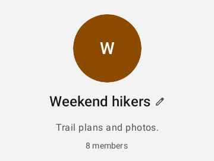 | **Title, supporting text, metadata.** The group name is the heading. The description and member count read underneath it. The pencil acts on the name. Use the header’s semantic hierarchy instead of shrinking secondary text by eye. [GroupDetailsHeader](../app/src/main/java/dev/ipf/whitenoise/android/ui/group/GroupDetailsHeader.kt) |
| 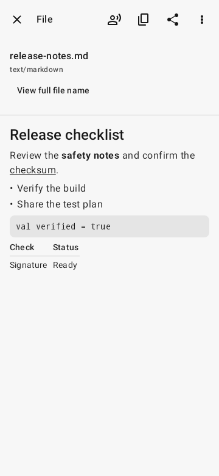 | **Body copy, links, and rich text.** Use the reader when someone opens a document. Preserve headings, lists, links, tables, and selection where the renderer supports them. Keep message previews compact and open the full content for sustained reading. [MarkdownRenderer](../app/src/main/java/dev/ipf/whitenoise/android/ui/MarkdownRenderer.kt) |
| 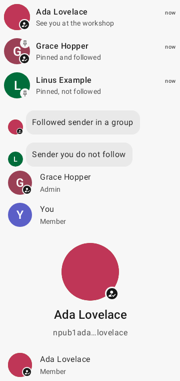 | **Person and group avatars.** Pair identity artwork with a visible name in a list. Let the avatar owner handle the photo, fallback, and any meaningful overlay. Use [the group avatar](../app/src/main/java/dev/ipf/whitenoise/android/ui/common/GroupAvatar.kt) for group identity. Initials, badge, and background should remain legible at the size used in the row. [Avatar](../app/src/main/java/dev/ipf/whitenoise/android/ui/common/Avatar.kt) |
|  | **Badges, dots, and counts.** Use a badge for status attached to another object. A manually marked unread dot and a numeric count communicate different information. Keep badge placement stable as the count grows, and carry the meaning in its text or semantics. [Badges](../app/src/main/java/dev/ipf/whitenoise/android/ui/common/Badges.kt) |
| 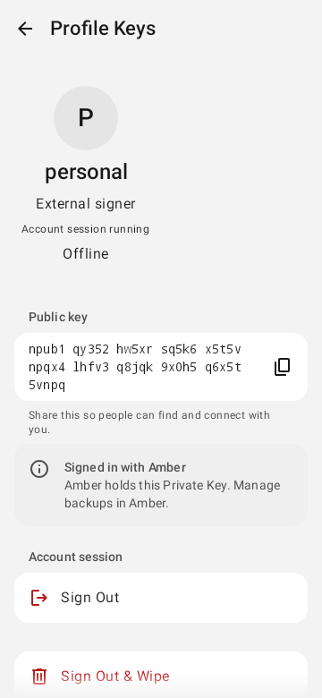 | **Icons and copyable values.** Use a familiar Android action glyph, a localized accessible name, and Material touch feedback. A copy icon next to a public identifier acts on that value. Keep selectable or copyable values distinct from editable inputs. Use the [copyable row](../app/src/main/java/dev/ipf/whitenoise/android/ui/common/CopyableValueRow.kt) where it fits. [PublicKeyCopy](../app/src/main/java/dev/ipf/whitenoise/android/ui/common/PublicKeyCopy.kt) |

## Page layout, stacked content, and navigation

Start with Material’s scaffold, app bar, lists, and adaptive layouts. Decide how things relate before choosing gaps. Use component defaults inside each element and [WhiteNoiseSpacing](../app/src/main/java/dev/ipf/whitenoise/android/ui/theme/WhiteNoiseSpacing.kt) for space between related controls, sections, and page edges. Assign ownership of system-bar, keyboard, and content insets once. [Google’s adaptive layouts](https://developer.android.com/develop/ui/compose/layouts/adaptive)

| Current app example | When and how to use the pattern |
| --- | --- |
| 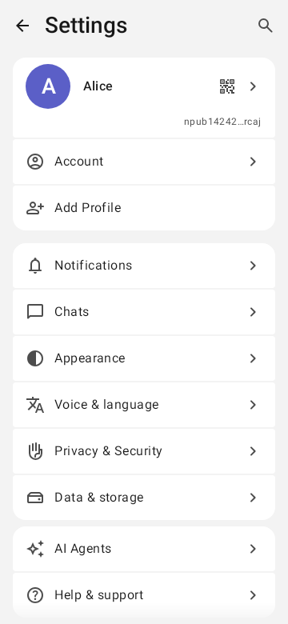 | **Page, top bar, and section stack.** A destination owns its title, navigation action, and content. Stack sections in reading order with one consistent start edge. Use [the shared scaffold](../app/src/main/java/dev/ipf/whitenoise/android/ui/common/WhiteNoiseScaffold.kt) or the Settings scaffold. Keep section spacing distinct from the smaller gaps between rows. [SettingsLayout](../app/src/main/java/dev/ipf/whitenoise/android/ui/settings/SettingsLayout.kt) |
| 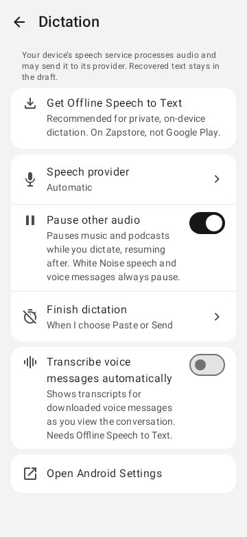 | **Sections, cards, dividers, and grouped rows.** Group controls that answer the same question. Use a card for a distinct subject, a section for a related list, and a divider when adjacent content needs a boundary. Let [the grouped-row component](../app/src/main/java/dev/ipf/whitenoise/android/ui/common/WhiteNoiseListItemDefaults.kt) own first, middle, last, and standalone corners. Avoid individual radii or extra outer padding on each row. [SettingsComponents](../app/src/main/java/dev/ipf/whitenoise/android/ui/settings/SettingsComponents.kt) |
| 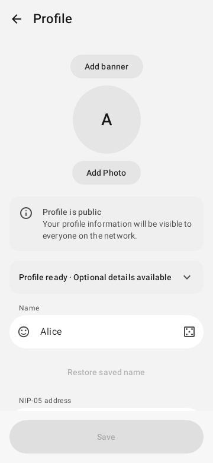 | **Identity header and editable content.** Keep identity, explanation, editable fields, and the form action in that order when the task is editing a profile. A notice belongs near the decision it informs. Give a bottom action space above the keyboard and navigation bar. [ProfileEditContent](../app/src/main/java/dev/ipf/whitenoise/android/ui/profile/ProfileEditContent.kt) |
| 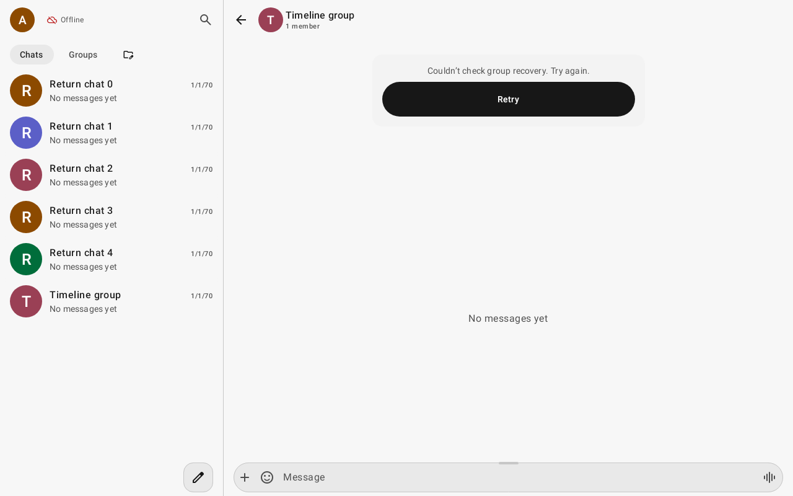 | **List and detail panes.** Use the available window to decide whether the list and selected detail fit side by side. Keep the selected item identifiable. Handle Back, keyboard, and window changes through the existing navigation owner. [TwoPaneChatLayout](../app/src/main/java/dev/ipf/whitenoise/android/ui/navigation/TwoPaneChatLayout.kt) |
| 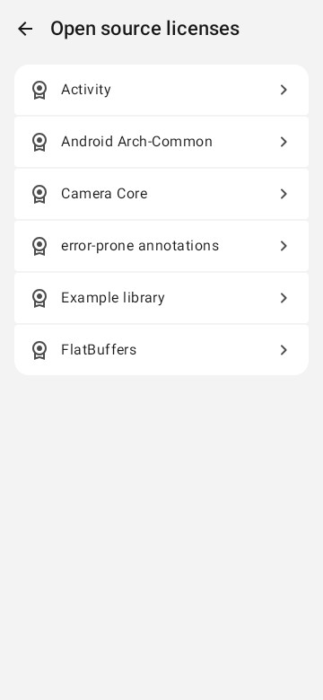 | **Top-bar navigation and tools.** Use Back to retrace browsing. Keep commands that affect the current destination in its app bar. Give an overflow button the set of actions appropriate to that scope. [Shared app bar](../app/src/main/java/dev/ipf/whitenoise/android/ui/common/WhiteNoiseTopBar.kt). [OpenSourceLicensesScreen](../app/src/main/java/dev/ipf/whitenoise/android/ui/settings/OpenSourceLicensesScreen.kt) |

## Buttons, controls, and input

Choose the control by the effect of activating it. Use the Material role and its content slots first. Keep a visible label for an unfamiliar or consequential action. Color, position, and an icon alone cannot explain its consequence.

| Current app example | When and how to use the pattern |
| --- | --- |
| 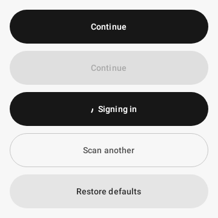 | **Filled, tonal, outlined, and text buttons.** Use a filled button for the main task, toned-down emphasis for a supporting action, and text buttons for compact actions such as Cancel. An outlined button suits an independently available alternative. Keep the named action understandable while it is disabled or busy. Use the existing wrappers for the corresponding Material button. [WhiteNoiseButtons](../app/src/main/java/dev/ipf/whitenoise/android/ui/common/WhiteNoiseButtons.kt) |
| 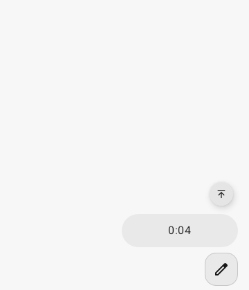 | **Icon buttons and floating actions.** Use an icon button for a familiar local command. Reserve a floating primary action for a task such as starting a chat. A jump control depends on scroll position. Keep the visible shape and pressed indication aligned while preserving the touch target. [Floating control stack](../app/src/main/java/dev/ipf/whitenoise/android/ui/navigation/FloatingControlStack.kt). [ChatsNewMessageFab](../app/src/main/java/dev/ipf/whitenoise/android/ui/chats/ChatsNewMessageFab.kt) |
| 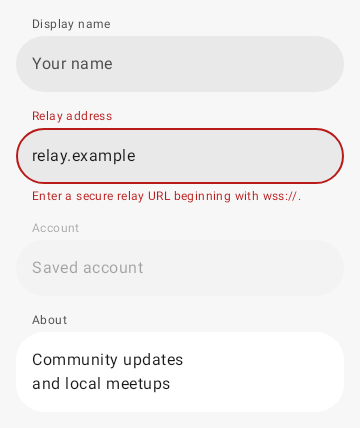 | **Fields, labels, placeholders, and errors.** Keep a persistent label for the value being edited. Supporting text explains a constraint or how to fix the input. Use error text with the semantic error color. Allow long content to wrap in multiline fields. The shared field supplies the label, icon, focus, editing and supporting-text slots. [WhiteNoiseTextField](../app/src/main/java/dev/ipf/whitenoise/android/ui/common/WhiteNoiseTextField.kt) |
| 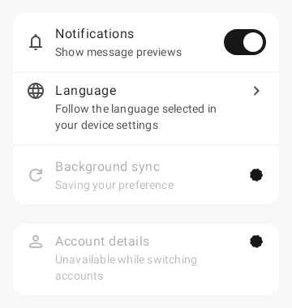 | **Switches and disclosure rows.** Use a switch for a binary setting that takes effect on activation. A chevron opens more content. If the whole row toggles, give the switch and row one coherent action. For unavailable rows, explain the reason when it helps someone proceed. [SettingsComponents](../app/src/main/java/dev/ipf/whitenoise/android/ui/settings/SettingsComponents.kt) |
| 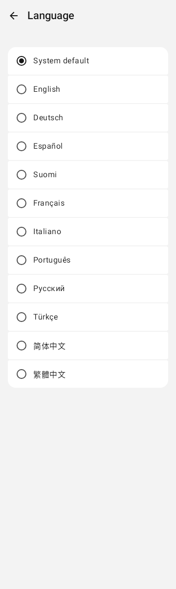 | **Radio choices.** Use a radio group for mutually exclusive options and make the whole row selectable. App language applies on tap and stays visible so the result can be seen. Other choices can have a different commit point. Identify it explicitly. [LanguageScreen](../app/src/main/java/dev/ipf/whitenoise/android/ui/settings/LanguageScreen.kt) |
| 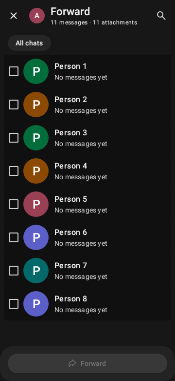 | **Checkboxes and multi-selection.** Use a checkbox when several independent items can be selected. In Forward, checking a chat changes the recipient set. Only Forward starts the task. Preserve clear unselected, selected, and unavailable states. [ForwardMessagePicker](../app/src/main/java/dev/ipf/whitenoise/android/ui/conversation/messages/ForwardMessagePicker.kt) |
| 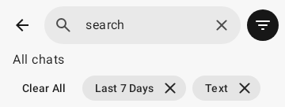 | **Search fields and removable filter chips.** Typing changes the query. Each chip names one applied constraint and can be removed independently. Keep clearing the query, removing a filter, and clearing the whole filter set distinguishable. [GlobalSearchFilterUi](../app/src/main/java/dev/ipf/whitenoise/android/ui/chats/GlobalSearchFilterUi.kt) |
| 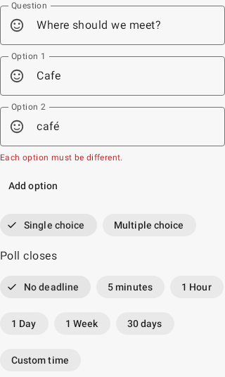 | **Segmented choices and staged forms.** Use a compact choice group when people need to compare a few peers in place. Keep the selected state visible. Show validation beside the affected field and preserve the other draft entries until the form is submitted. [PollCreateDialog](../app/src/main/java/dev/ipf/whitenoise/android/ui/conversation/PollCreateDialog.kt) |
| 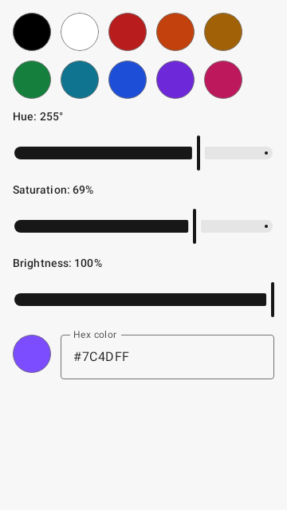 | **Sliders, swatches, and precise input.** Use a slider for a continuous adjustment, a swatch for a preset, and a labelled value for precise entry. These colors are the content being edited. The controls around them still follow the app theme. [FullSpectrumColorPicker](../app/src/main/java/dev/ipf/whitenoise/android/ui/settings/FullSpectrumColorPicker.kt) |
| 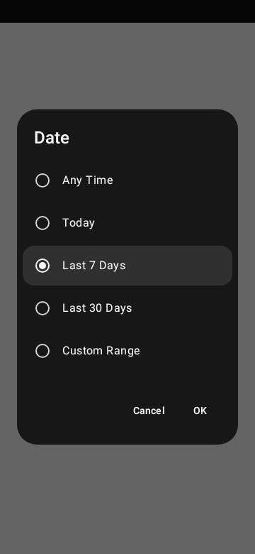 | **Dates, times, and ranges.** Use recognizable presets and provide the appropriate date or time picker when a precise value is needed. In this filter, OK commits a staged selection and Cancel abandons it. Use the [shared date picker](../app/src/main/java/dev/ipf/whitenoise/android/ui/common/CivilDatePickerDialog.kt) for calendar input. [GlobalSearchDateFilterDialog](../app/src/main/java/dev/ipf/whitenoise/android/ui/search/GlobalSearchDateFilterDialog.kt) |

## Sheets, dialogs, menus, and other overlays

A modal interrupts the current flow. Choose its container from the task, its length, the context the person needs to retain, and how it ends. Make Close, Cancel, Back, applying a choice, and confirming a destructive action do what their labels promise. The specific White Noise assignments below are current examples. The [surface review index](https://github.com/marmot-protocol/whitenoise-android/issues/4093#issuecomment-7134326632) records proposals awaiting review.

| Current app example | When and how to use the pattern |
| --- | --- |
|  | **Full-screen task.** Give a substantial task with staged work room for selection, search, and a named completion action. Close leaves the task. Compare this with the licenses page above, where a row leads deeper into a hierarchy. [ForwardMessagePicker](../app/src/main/java/dev/ipf/whitenoise/android/ui/conversation/messages/ForwardMessagePicker.kt) |
| 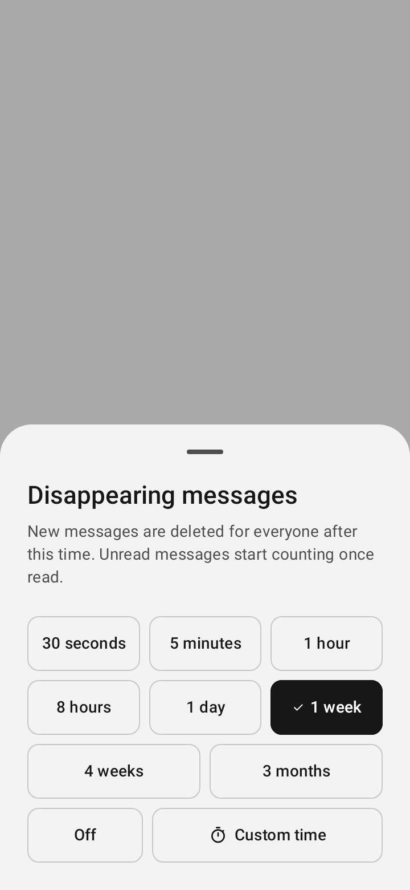 | **Modal bottom sheet.** Use a sheet for a secondary task tied to the current screen. The chat timer is a contextual setting. Preserve the existing confirmation for choices that need one. Start with the [shared Material sheet and header](../app/src/main/java/dev/ipf/whitenoise/android/ui/common/WhiteNoiseSheets.kt) and check content insets, scrolling, keyboard and dismissal. [DisappearingTimerSheet](../app/src/main/java/dev/ipf/whitenoise/android/ui/group/DisappearingTimerSheet.kt) |
| 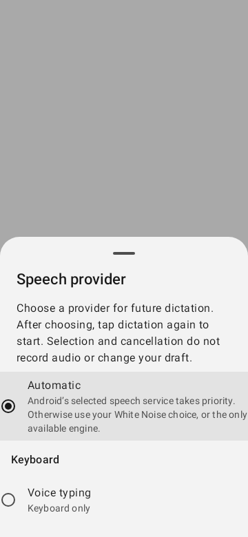 | **Picker sheet with an identified defect.** The radio row assumes a dialog's content inset. Its position here is a known spacing defect. It should not be used as a layout template. The [picker decision](https://github.com/marmot-protocol/whitenoise-android/issues/4094#issuecomment-7134310139) addresses which container fits. The [row issue](https://github.com/marmot-protocol/whitenoise-android/issues/4064) addresses the spacing. [DictationProviderSheet](../app/src/main/java/dev/ipf/whitenoise/android/ui/settings/DictationProviderSheet.kt) |
| 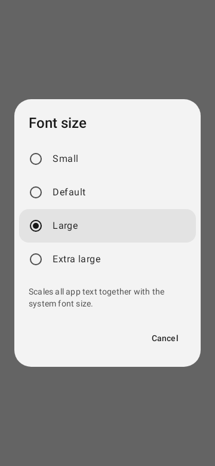 | **Simple choice dialog.** A dialog suits a short, focused choice when the person can identify the answer without browsing. The shared ChoiceDialog passes the chosen value to the caller. This is a generic fixture. The actual font settings have their own preview behavior. [WhiteNoiseDialogs](../app/src/main/java/dev/ipf/whitenoise/android/ui/common/WhiteNoiseDialogs.kt) |
| 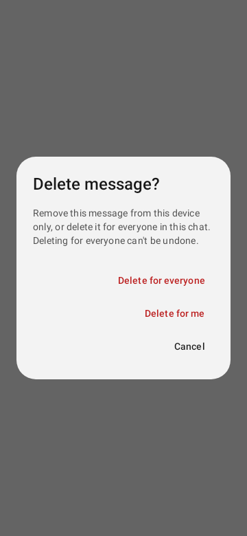 | **Confirmation dialog.** Name the object and consequence before an irreversible action. Keep local and shared deletion distinguishable, preserve capability checks, and make Cancel safe. Use the theme error role for the destructive action. [MessageDeleteDialog](../app/src/main/java/dev/ipf/whitenoise/android/ui/conversation/messages/MessageDeleteDialog.kt) |
| 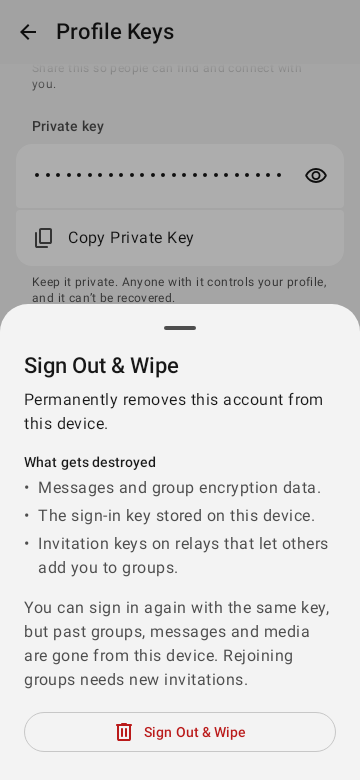 | **Consequences that need explanation.** The current account flow uses a sheet to explain which local data disappears. Treat its wording, scope, and existing confirmation steps as part of the interaction. Its container is under review in [the sheet decision](https://github.com/marmot-protocol/whitenoise-android/issues/4096). [AccountWipeAndSignOut](../app/src/main/java/dev/ipf/whitenoise/android/ui/settings/AccountWipeAndSignOut.kt) |
| 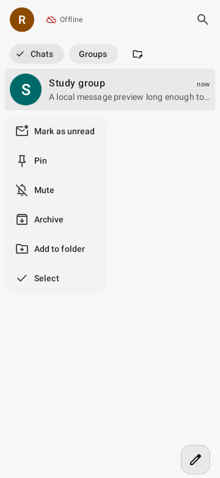 | **Anchored menu and overflow.** A row menu contains commands for that chat. A toolbar overflow is anchored to its button and acts on the screen. Prefer [shared Material dropdown items](../app/src/main/java/dev/ipf/whitenoise/android/ui/common/WhiteNoiseMenus.kt). Keep the menu inside the visible window and return focus to its origin. [ChatActionSheet](../app/src/main/java/dev/ipf/whitenoise/android/ui/chats/ChatActionSheet.kt) |
| 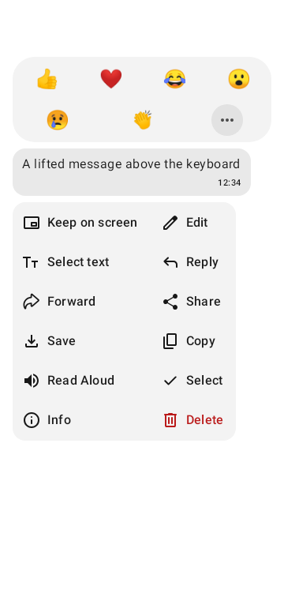 | **Long-press message actions.** Keep the message identifiable while the person reacts or invokes a command. Reserve room for the last menu row and account for the keyboard. This custom combination is being reviewed in [the menu issue](https://github.com/marmot-protocol/whitenoise-android/issues/4098). [FocusedMessageActions](../app/src/main/java/dev/ipf/whitenoise/android/ui/conversation/messages/FocusedMessageActions.kt) |
| 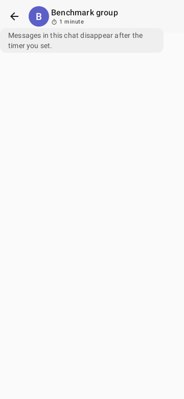 | **Tooltip or brief explanation.** Use short anchored help to explain a control. Information required to choose safely belongs in visible supporting text or the confirmation. A tooltip should leave the underlying control and navigation usable. [Conversation header tooltip](../app/src/main/java/dev/ipf/whitenoise/android/ui/conversation/ConversationTopBar.kt) |

## Chat lists, messages, and the timeline

Google supplies layout, type, state, and interaction primitives. A message bubble also carries White Noise data: sender, delivery state, content, replies, and reactions. Reuse the production timeline components so those relationships survive changes in content.

| Current app example | When and how to use the pattern |
| --- | --- |
| 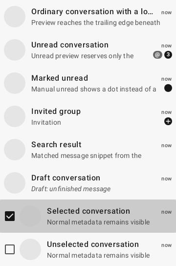 | **Chat row and selection mode.** Give the chat name first priority, the latest useful preview second, and time and status a stable trailing position. Use a check for selection and preserve unread meaning separately. Keep an invitation or draft identifiable by its label. [ChatRowLayout](../app/src/main/java/dev/ipf/whitenoise/android/ui/chats/ChatRowLayout.kt) |
|  | **Swipe action.** Use a configured swipe as a shortcut for an existing chat command. Show which action the gesture will perform. Make the action available through the ordinary row controls or menu as well. [ChatSwipeActions](../app/src/main/java/dev/ipf/whitenoise/android/ui/chats/ChatSwipeActions.kt) |
| 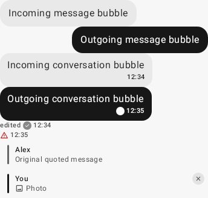 | **Incoming and outgoing bubbles.** Use the message bubble owner for alignment, body, timestamp, and delivery state. Let text wrap around its real content, including long messages and short single-line replies. The same message should remain recognizable when selected or shown in context. [MessageBubble](../app/src/main/java/dev/ipf/whitenoise/android/ui/conversation/messages/MessageBubble.kt) |
| 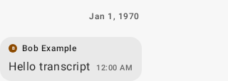 | **Sender runs, avatars, and date separators.** Show enough sender context to identify the author in a group. Use the [existing sender-run calculation](../app/src/main/java/dev/ipf/whitenoise/android/ui/conversation/ConversationBubbleGrouping.kt) to determine where adjacent bubbles belong together. Let day and system-event boundaries break the run. [TimelineRow](../app/src/main/java/dev/ipf/whitenoise/android/ui/conversation/TimelineRow.kt) |
| 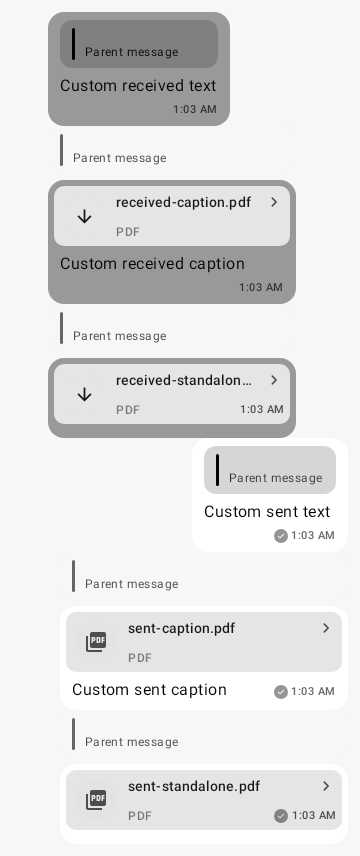 | **Reply quotes and attached captions.** Keep the quoted sender and excerpt distinct from the new message body. A document name, caption, or unavailable preview still needs a readable fallback. Quoting another message should preserve which content belongs to whom. [ReplyPreviewCard](../app/src/main/java/dev/ipf/whitenoise/android/ui/conversation/replies/ReplyPreviewCard.kt) |
| 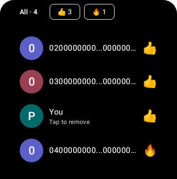 | **Reaction pill and reaction details.** Keep the compact [reaction pill](../app/src/main/java/dev/ipf/whitenoise/android/ui/conversation/reactions/ReactionPills.kt) attached to the message it describes. Open details when the person needs to inspect who reacted. Preserve the selected emoji filter and make an available remove action identifiable. [CompleteReactionDetailsSheet](../app/src/main/java/dev/ipf/whitenoise/android/ui/conversation/reactions/CompleteReactionDetailsSheet.kt) |
| 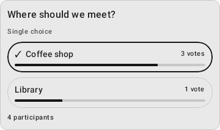 | **Content cards and polls.** Use a contained card for structured message content with its own actions. Keep the question, selected option, result, and participation count readable within the bubble. Preserve the distinction between viewing, voting, and inspecting participants. [PollTimelineRow](../app/src/main/java/dev/ipf/whitenoise/android/ui/conversation/PollTimelineRow.kt) |
| 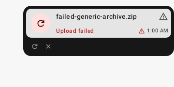 | **Attachment and failed transfer in a bubble.** Keep filename and transfer state attached to the same file. Failure should explain what happened and expose the recovery action the app supports. An upload retry applies to that attachment. [FileBubbleContent](../app/src/main/java/dev/ipf/whitenoise/android/ui/conversation/media/FileBubbleContent.kt) |

## Composer, attachments, and playback

A composer holds work in progress. Keep text, the reply target, the sending identity where relevant, and staged media visible through editing. Actions such as Remove, Cancel, Send, and Retry apply to different objects. Place each action next to the object it affects.

| Current app example | When and how to use the pattern |
| --- | --- |
| 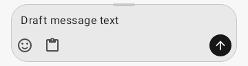 | **Idle composer and typing.** The [idle fixture](../app/src/test/snapshots/composer_bar_idle_light.png) shows the entry state. Once the person types, preserve editing space and grow the field within the available height. Use the production composer’s current send and recording actions and respect the keyboard insets. [ComposerBar](../app/src/main/java/dev/ipf/whitenoise/android/ui/conversation/composer/ComposerBar.kt) |
| 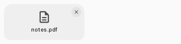 | **Staged reply and attachment shelf.** Put a reply target or staged file close to the draft it qualifies. Removing a file should act on that item. Keep attachment name or thumbnail visible, and use the larger hit area of the shared remove control. [Reply preview fixture](../app/src/test/snapshots/composer_reply_entrance_settled_light.png). [ComposerAttachmentShelf](../app/src/main/java/dev/ipf/whitenoise/android/ui/conversation/media/ComposerAttachmentShelf.kt) |
| 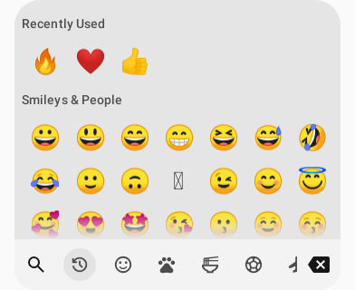 | **Emoji and category navigation.** Use a grid when the artwork is what people recognize. Keep browse, category navigation, search, and backspace visually distinct. Use the production picker so choosing an item updates the right draft or reaction. [EmojiPicker](../app/src/main/java/dev/ipf/whitenoise/android/ui/conversation/composer/EmojiPicker.kt) |
| 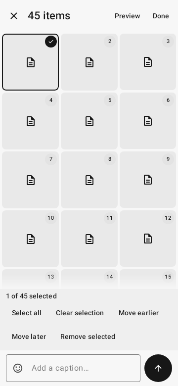 | **Multi-item attachment selection.** Use a grid for visual selection, display the selected count, and expose preview and completion explicitly. Apply batch commands only to the current selection. Keep collection-level actions apart from the caption field. [MediaCollectionGrid](../app/src/main/java/dev/ipf/whitenoise/android/ui/conversation/media/MediaCollectionGrid.kt) |
|  | **Voice recording and transport.** Recording needs a persistent indication of capture, elapsed time, and the available controls. Show review, discard, and send at the stages where they are available. Playback has different controls and state from capture. [VoiceRecordingStrip](../app/src/main/java/dev/ipf/whitenoise/android/ui/conversation/composer/VoiceRecordingStrip.kt) |
|  | **Playback and progress.** The progress indicator shows the current position. Keep play/pause, speed, stop, and previous/next sentence together. Put previous/next message in More options. Voice notes keep both ten-second seek buttons on the strip. The shell bar's placement is an [open product decision](https://github.com/marmot-protocol/whitenoise-android/issues/4104). [TtsTransportBar](../app/src/main/java/dev/ipf/whitenoise/android/ui/conversation/TtsTransportBar.kt) |
| 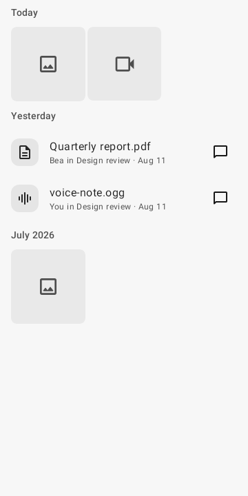 | **Files, media grids, and viewers.** Use tiles for visual browsing and rows for filename, type, and metadata. Open the relevant reader or viewer for details. [Shared Media](../app/src/main/java/dev/ipf/whitenoise/android/ui/medialibrary/MediaLibrary.kt) and the global attachment browser are separate entry points. [File-type examples](../app/src/test/snapshots/attachment_type_gallery_light.png). [GlobalAttachmentBrowser](../app/src/main/java/dev/ipf/whitenoise/android/ui/chats/GlobalAttachmentBrowser.kt) |
| 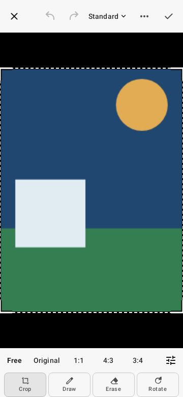 | **Photo editing.** Give editing tools room around the media and indicate the current tool. Distinguish leaving the editor from accepting edits. Use the existing editor or Android picker contract appropriate to the task. [PhotoEditorScreen](../app/src/main/java/dev/ipf/whitenoise/android/ui/conversation/media/editor/PhotoEditorScreen.kt) |

## Feedback, progress, and recovery

Place feedback where the person can connect it to the originating action. Keep transient success lightweight. Keep an actionable failure visible for as long as its recovery matters. Preserve existing loading, empty, blocked, and failure states.

| Current app example | When and how to use the pattern |
| --- | --- |
| 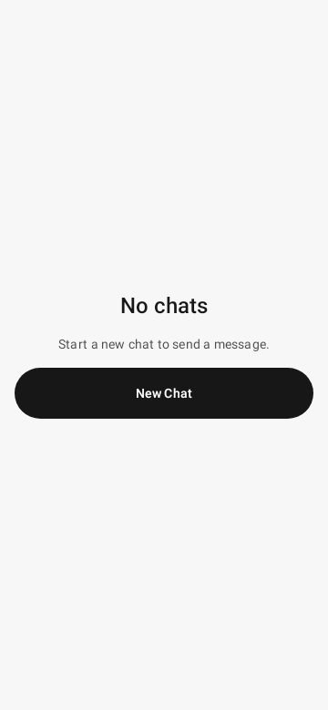 | **Empty state.** Explain what normally belongs here and, where possible, give one action that creates it. Keep a genuinely empty list distinct from a search with no matches or data that is still loading. [ChatListEmptyStates](../app/src/main/java/dev/ipf/whitenoise/android/ui/chats/ChatListEmptyStates.kt) |
|  | **Loading and indeterminate progress.** Show which operation is in progress when a generic spinner would be ambiguous. Keep available content usable where the underlying operation permits. Reserve percentages for measured progress. [GlobalSearchResults](../app/src/main/java/dev/ipf/whitenoise/android/ui/chats/GlobalSearchResults.kt) |
| 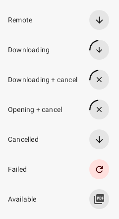 | **Transfer progress, cancel, and retry.** Show transfer state on its item. A progress ring indicates work in flight. Offer cancel and retry only in states that support them. When available, opening the item replaces the transfer action. [TileTransfer](../app/src/main/java/dev/ipf/whitenoise/android/ui/conversation/media/TileTransfer.kt) |
| 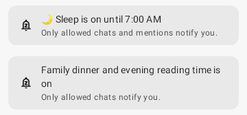 | **Inline callout and persistent banner.** Use a visible notice for a state that changes what the person can expect on this screen. Explain the practical consequence. A recoverable error can include a local action, as in the [timeline recovery banner](../app/src/test/snapshots/error_recovery_banner_light.png). [Shared callout](../app/src/main/java/dev/ipf/whitenoise/android/ui/common/WhiteNoiseCallout.kt). [Notification profile status](../app/src/main/java/dev/ipf/whitenoise/android/ui/chats/NotificationProfileStatus.kt) |
| 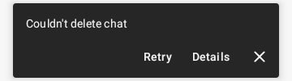 | **Snackbar with a recovery action.** Name the outcome and offer an action that can actually recover it. Retry repeats the attempted operation. Undo restores an earlier state. Closing the snackbar must never trigger Retry. [LocalDeleteSnackbar](../app/src/main/java/dev/ipf/whitenoise/android/ui/common/LocalDeleteSnackbar.kt) |
| 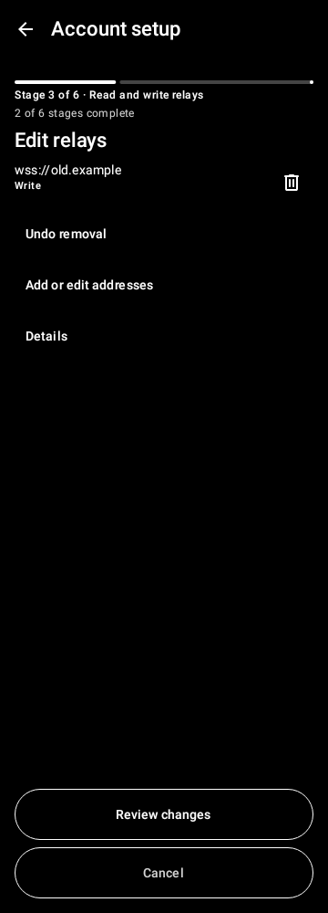 | **Reversible staged edits.** For a change still inside a draft, an inline Undo beside the list keeps the recovery visible. Keep restoring the entry separate from reviewing or committing the new settings. [AccountSetupRelayEditor](../app/src/main/java/dev/ipf/whitenoise/android/ui/onboarding/setup/AccountSetupRelayEditor.kt) |

## Account flows and Android-owned surfaces

Use Material for the app's part of a flow. Let Android own its permission prompt, system picker, Sharesheet, and notification presentation. White Noise supplies the request, content, and return behavior. The monochrome app palette applies to app-owned chrome.

| Current app example | When and how to use the pattern |
| --- | --- |
| 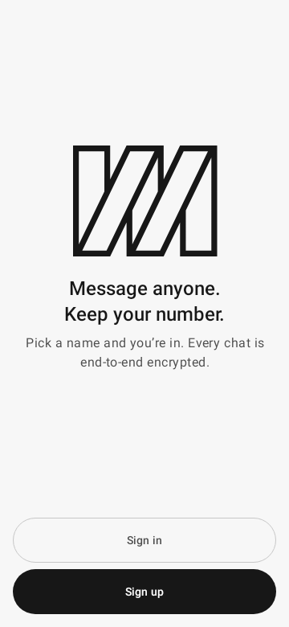 | **Onboarding and sign-in.** Distinguish the primary start action from the secondary path. Keep progress, validation, and recovery inside the step where someone can act on them. Secure input needs a visible label and the platform’s appropriate input behavior. [OnboardingScreen](../app/src/main/java/dev/ipf/whitenoise/android/ui/onboarding/OnboardingScreen.kt) |
| 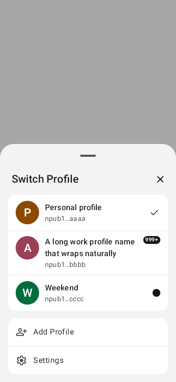 | **Account switching.** Identify the active account with a selection marker and name. Place account management actions away from selectable identities so an ordinary switch is unambiguous. [AccountSelectorSheet](../app/src/main/java/dev/ipf/whitenoise/android/ui/account/AccountSelectorSheet.kt) |
| 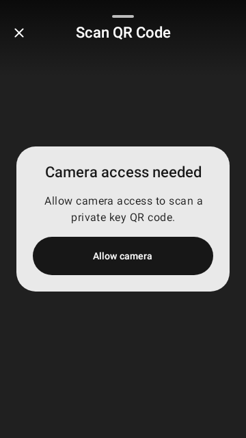 | **Permission rationale and scanner.** Explain why camera access serves this scan. The app action can request permission. Android presents the permission decision. Handle denial and returning to the originating flow. The fixture shows the app's explanation. [QrScannerSheet](../app/src/main/java/dev/ipf/whitenoise/android/ui/qr/QrScannerSheet.kt) |
| 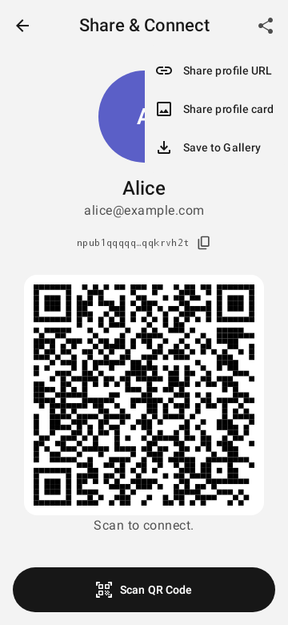 | **System sharing and picking media.** The app can ask what to share before handing the content to Android. Use the Android Sharesheet for external destinations and the system Photo Picker or Files contract for device content. Preserve the originating task when the person cancels. [Android Photo Picker](https://developer.android.com/training/data-storage/shared/photopicker) · [Android Sharesheet](https://developer.android.com/training/sharing/send). [ShareConnectScreen](../app/src/main/java/dev/ipf/whitenoise/android/ui/settings/ShareConnectScreen.kt) |
| 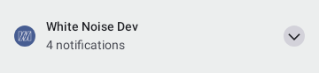 | **System notification and grouping.** Use Android notification templates, channels, grouping, and supported actions. Keep notification content and the destination reached from a tap consistent with the active account and privacy settings. [NotificationCardContent](../app/src/main/java/dev/ipf/whitenoise/android/notifications/NotificationCardContent.kt) |

## Related patterns and specialized flows

| Pattern | Where and why |
| --- | --- |
| Tabs, folders, and navigation controls | Use tabs for peer views of the same subject, as in the HTML viewer’s Rendered and Source tabs. A folder selection filters the chat list. Keep a removable filter chip visually distinct from a destination. Choose an app bar, rail, or other navigation component according to the window and hierarchy. [Document viewer](../app/src/main/java/dev/ipf/whitenoise/android/ui/conversation/media/DocumentAttachmentViewer.kt) · [Folder pills](../app/src/main/java/dev/ipf/whitenoise/android/ui/chats/ChatFolderPills.kt) |
| Toolbars, bottom action bars, and selection mode | Keep page commands in the app bar and a form’s commit action visible with the keyboard open. When selecting messages, show the selection count and only the actions the selection supports. [Sticky form action bar](../app/src/main/java/dev/ipf/whitenoise/android/ui/common/StickyFormActionBar.kt) · [Message selection bar](../app/src/main/java/dev/ipf/whitenoise/android/ui/conversation/MessageSelectionBar.kt) |
| People pickers, mentions, and autocomplete | Use searchable people rows for a recipient task. Inline mentions belong with the typed query and insert into the draft. Picking a recipient, inserting a mention, and sending to the recipient are distinct actions. [New Message](../app/src/main/java/dev/ipf/whitenoise/android/ui/chats/newchat/NewMessagePresentation.kt) · [Mention picker](../app/src/main/java/dev/ipf/whitenoise/android/ui/conversation/composer/MentionPicker.kt) |
| Disclosure and expandable details | Use a disclosure row for another destination. Expand inline when the person needs more detail about the same object. Show whether content is expanded. Keep the original item visible and preserve its state on collapse. [Profile readiness](../app/src/main/java/dev/ipf/whitenoise/android/ui/profile/ProfileReadiness.kt) · [Profile example](../app/src/test/snapshots/profile_editing_light.png) |
| Drawers, rails, and standard bottom sheets | A navigation drawer or rail holds app destinations. A standard bottom sheet can coexist with an interactive underlying screen. A modal sheet takes focus and requires dismissal. Choose these only for a matching navigation or containment need. The [Android component catalog](https://developer.android.com/develop/ui/compose/components) describes the alternatives. |
| Conversation-specific content | For voice notes, images, video, stickers, quoted links, and protocol-event cards, use the existing renderer for that content. Keep the same sender attribution, transfer state, and opening action when a message includes a caption or reply. [Media renderers](../app/src/main/java/dev/ipf/whitenoise/android/ui/conversation/media) · [Stickers](../app/src/main/java/dev/ipf/whitenoise/android/ui/conversation/stickers) · [Nostr cards](../app/src/main/java/dev/ipf/whitenoise/android/ui/conversation/nostr) |
| Trust, device linking, and account recovery | Keep trust and approval decisions explicit. Preserve the identity of the account or device, the consequence of proceeding, and cancellation or recovery. Pick the Material surface that gives those facts room. [Device-link approval](../app/src/main/java/dev/ipf/whitenoise/android/ui/devices/DeviceLinkApproval.kt) · [Device-link comparison example](../app/src/test/snapshots/device_link_request_comparing_light.png) |
| Gestures, motion, and transient state | Swiping a chat, replying to a message, moving between Settings pages, and opening the keyboard have different end states. Follow the relevant owner for gesture thresholds, direction, reversible motion, and restoring focus. Use interaction evidence for motion claims. [Message reply gesture](../app/src/main/java/dev/ipf/whitenoise/android/ui/conversation/messages/MessageReplySwipe.kt) · [Settings motion](../app/src/main/java/dev/ipf/whitenoise/android/ui/settings/SettingsRouteMotion.kt) |
| Find another feature or state | Start with the [release testing guide](manual-release-testing.md) for the route and named behavior. Use the [source-to-surface inventory](manual-release-testing-surfaces.json) and [committed screenshot collection](../app/src/test/snapshots) to locate the feature’s implementation and fixtures. |

## How to use examples in a review

Open the screenshot and the linked Kotlin together. Identify the actual screen
or fixture, the user’s task, the component, and which part of the interaction
the evidence establishes. If the screenshot is from a different revision,
identify it. Use Google’s documentation for a Material rule. If a claim
depends on how a Pixel app behaves, identify the Google app, version, and
observed state. A current White Noise screenshot documents today’s behavior.

Keep the [surface review index](https://github.com/marmot-protocol/whitenoise-android/issues/4093#issuecomment-7134326632)
as the discussion for proposed choices. When a decision is accepted, update
the corresponding guide entry with the reason and a representative app
example. Check affected entries when the underlying component changes.
