# UI patterns

Shared rules for Android screen chrome and interaction containers. They come
from the UI unification tracker (#4049) and the interaction decisions under
#4093. Each slice adds its rule here when it lands. For choosing
a component or pattern, see the [illustrated UI guide](android-ui-patterns.md).

## Page top bar and scaffold

Every ordinary page uses `WhiteNoiseTopBar` inside `WhiteNoiseScaffold`
([`ui/common/WhiteNoiseTopBar.kt`](../app/src/main/java/dev/ipf/whitenoise/android/ui/common/WhiteNoiseTopBar.kt),
[`ui/common/WhiteNoiseScaffold.kt`](../app/src/main/java/dev/ipf/whitenoise/android/ui/common/WhiteNoiseScaffold.kt)).
Settings pages use `SettingsScaffold`, which wraps both. Do not build a page
from a raw `Scaffold`, `TopAppBar` or `CenterAlignedTopAppBar`.

The shared bar gives every page the same:

- start-aligned title in `titleLarge`, with an optional `titleContent` for a
  subtitle such as a selection count;
- leading control (see below), disabled with `navigationEnabled = false`
  while the page commits work;
- bar colour: `containerColor` matches the page canvas and the bar tints to
  `surfaceContainer` when content scrolls under it. Scrolling content needs
  `whiteNoiseVerticalScroll` or a `WhiteNoiseLazyColumn` for the tint to follow;
- banner slot directly below the bar (#3312), placed by the scaffold.

A page whose banner slot must sit above other bar content, such as its own
snackbar host, passes `topNoticeSlot = false` and places `TopNoticeSlot()`
itself.

Out of scope for this rule: the chat list top bar and the collapsing group
details header, which have their own designs. Attachment viewers use the
viewer chrome below.

## Attachment viewer chrome

Every attachment viewer uses `AttachmentViewerChrome`
([`ui/conversation/media/AttachmentViewerChrome.kt`](../app/src/main/java/dev/ipf/whitenoise/android/ui/conversation/media/AttachmentViewerChrome.kt)):
the image and video viewer, PDF and HTML documents, the text reader, the
Nostr event reader, video player and linked image, and the photo editor.

- It leads with Close (an X labelled Close), because a viewer returns to the
  message it opened from.
- The title is one line of `titleMedium` in semibold, with an optional
  `labelMedium` second line such as the sender's time and position.
- Direct actions follow the title, then one overflow slot behind the vertical
  ⋮, built on `WhiteNoiseDropdownMenu` as the toolbar-menu rule in #4098 says.
- Colours come from the theme. Readers dock the chrome on `surface`. Over
  edge-to-edge media it is the themed background under a heavy scrim, so the
  media still runs to the screen edges and the chrome pads itself clear of the
  status bar and side cutouts.

## Back arrow or X

The leading control says how the user got here.

| Control | Use it for | Examples |
| --- | --- | --- |
| Back arrow, labelled "Back" (`WhiteNoiseTopBarNavigation.Back`) | A page pushed onto the current stack, including a detail page shown as a full-screen dialog | Settings pages, Donate, Share & Connect, the contact picker, selection review, message details, edit history |
| X, labelled "Close" (`WhiteNoiseTopBarNavigation.Close`) | A modal or full-screen flow that returns to where it started when it is cancelled or finished, and viewers opened from a message | Share to, Forward, every attachment viewer (image, video, document, text, Nostr) and the photo editor |

The icon and its accessibility label always match: an arrow is "Back" and an X
is "Close", and Close always closes. Android system Back leaves the screen the
same way, except that it first dismisses a transient state on the screen, such
as a text selection.

## Interaction decisions (#4093)

The designer's proposals on #4094–#4098 are the accepted standard for which
container an interaction uses and how it applies. Each entry names the task,
the Material API, the White Noise component, what applies or dismisses it, and
a captioned screenshot. A surface that departs from these needs a recorded
exception here.

### Single-choice pickers (#4094)

Choose the container by what the person does with the options, then use
Material radio rows (`RadioButton` in a selectable row) for mutually exclusive
values, never check marks.

| Task | Material API | App component | Apply and dismiss |
| --- | --- | --- | --- |
| Pick from a short, familiar Settings list (Theme, Auto-lock, the default disappearing timer, Read aloud engine and speed) | `AlertDialog` with radio rows | `ChoiceDialog`, `SpeechChoiceDialog`, `DefaultDisappearingTimerDialog` | A tap applies and closes. Cancel or Back before a tap keeps the current value. A Custom row swaps the rows for its editor in the same dialog, never a second dialog. |
| Browse or search a catalog (App language, Read aloud voices, the Settings translation language) | Page with a top app bar and Back | `LanguageScreen`, `WhiteNoiseChoicePage`, `SpeechChoicePage`, `TranslationLanguagePickerPage` | The current choice is selected and in view. A tap applies. App language stays open so the new language shows; the other catalogs return to their opener. A provider with one or two simple alternatives can still use a dialog. |
| Change something for the current chat (disappearing timer, the in-chat translation language) | `ModalBottomSheet` | `WhiteNoiseModalBottomSheet`, `DisappearingMessagesPickerSheet`, `TranslationLanguagePickerSheet` | A tap applies and closes. A shorter timer keeps its in-sheet consequence warning and confirmation. |
| Compare live previews (Font size, App font, Date & time) | `AlertDialog` | `FontSizeDialog`, `DateTimeFormatDialog` | Each change applies at once and the dialog stays open. Done closes. |
| Audition a staged choice (vibration pattern) | `AlertDialog` | `ConversationNotifyDialogs` | Save applies, Cancel discards. |
| A small inline choice beside the setting it qualifies (smart-folder rule values, notification previews) | `DropdownMenu` or inline radios | `FolderChoice` on `WhiteNoiseDropdownMenu` | A tap applies. The current value is checked. |

Multi-select search filters keep their own apply behaviour. The Speech provider
sheet's rows belong to #4064.

| Screenshot | What to look for |
| --- | --- |
| 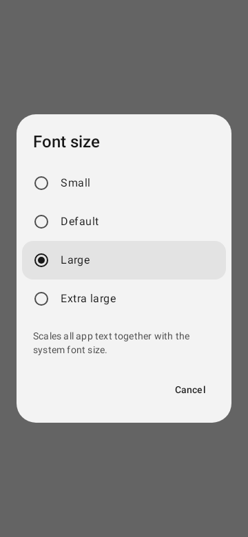 | Short list: radio rows, no confirm button, Cancel keeps the value. |
| 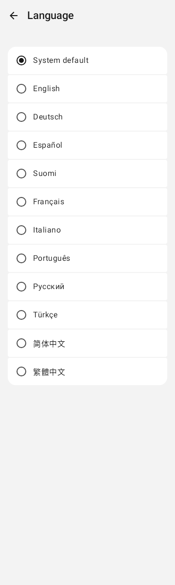 | Catalog page: Back, and the selected language visible before anything changes. |
| 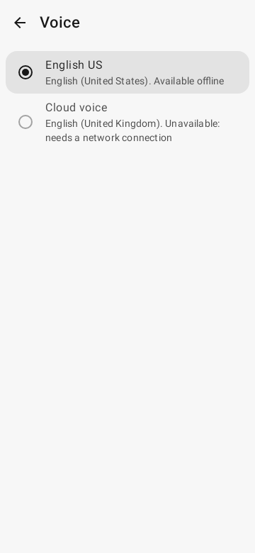 | The voice catalog on `SpeechChoicePage`: one radio row per voice, unavailable voices disabled with their reason. |
| 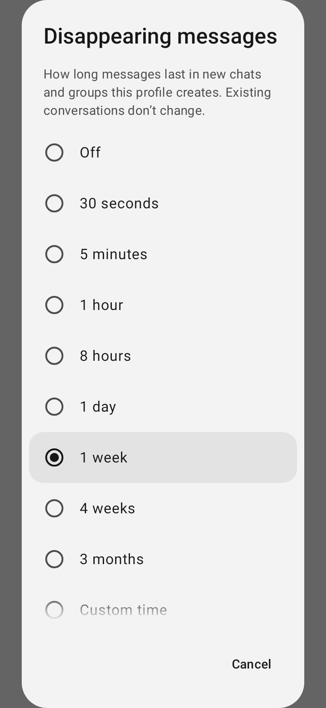 | A Settings default is a dialog, not the chat's sheet. |
| 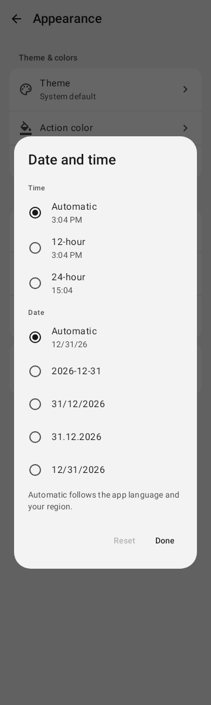 | Live preview: the change has already applied, so the button is Done. |

### Pages and full-screen dialogs (#4095)

| Task | Material API | App component | Apply and dismiss |
| --- | --- | --- | --- |
| Open a place to read or browse: Message info, a viewer, a Settings sub-page | Page with a top app bar and Back, predictive back | `SettingsScaffold` or `WhiteNoiseScaffold` with `WhiteNoiseTopBar` | The toolbar arrow and system Back return to the place that opened it. About → Developer returns to About, Help & support → Developer returns there, and a Settings search result returns to the results. |
| Start a task to finish or abandon: Forward, Share to, create and edit flows with staged changes | Full-screen dialog | `WhiteNoiseTopBar` with `WhiteNoiseTopBarNavigation.Close` | Selecting recipients only prepares the task. The named action (Forward) completes it. Close abandons it and returns to the conversation. |

Settings sub-pages are destinations in the Settings navigation
(`SettingsDetail` in `ui/navigation/AppDestinations.kt`), never content swapped
in place: Linked devices, Notification profiles, a relay's details, a stored
attachments list, an emoji set's preview and the licenses. Licenses is the
reference: About → Open source licenses → one notice are three pages, each
with Back. Opening a page pushes it above the page that opened it, an item page
carries its item in the route (`ShellRoute.Settings.arg`, such as the notice
or the relay URL), and the opened chain survives process death. A deep link or
notification that opens a page directly gets the page's fixed parents instead.

| Screenshot | What to look for |
| --- | --- |
| 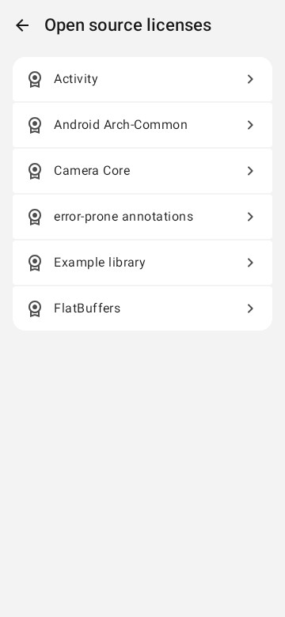 | A page to browse: Back, and rows that lead one level deeper. |
| 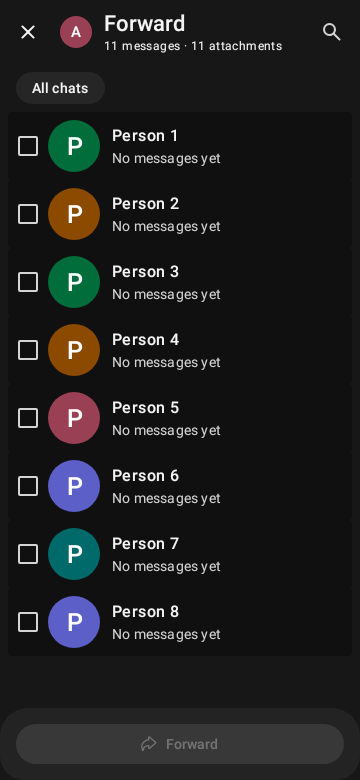 | A task: Close abandons, Forward submits. |

### Bottom sheets (#4096)

Use a modal bottom sheet for a secondary task whose meaning comes from what is
underneath it: who reacted to a message, media for the current draft, the
current chat's timer. Opening it keeps the originating message, draft or chat
position, and Back or a swipe dismisses it where the flow allows.

| Task | Material API | App component | Apply and dismiss |
| --- | --- | --- | --- |
| Secondary task tied to the screen underneath | `ModalBottomSheet` | `WhiteNoiseModalBottomSheet`, never Material's sheet directly | Back or swipe dismisses. A choice applies as the picker rules above say. |
| Camera scanner | Full-screen dialog | `QrScannerDialog`, with Close | Close and system Back turn the camera off and return to the flow that opened it. A scan result hands back to that flow. |
| A form that grows past one task | Page with Back | `SmartFolderPeopleConditionPage` | If finishing needs sheet → dialog → another picker, the flow is a page instead. The smart-folder People filter is one page with its people list inline; Back after a change asks before discarding. |
| Ongoing progress the person can leave | Inline status | — | Show it inline where the person can safely continue elsewhere. |

Recorded exception: Sign out and Sign out & wipe stay sheets
(`AccountWipeAndSignOut.kt`). Sign-out carries a key-package choice and wipe
needs room to explain what disappears. Their confirmation steps stay as they
are. A simple destructive decision anywhere else is a confirmation dialog.

| Screenshot | What to look for |
| --- | --- |
| 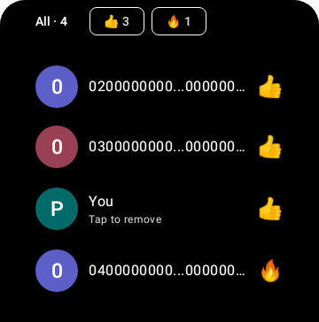 | A sheet whose content only makes sense over its message. |
| 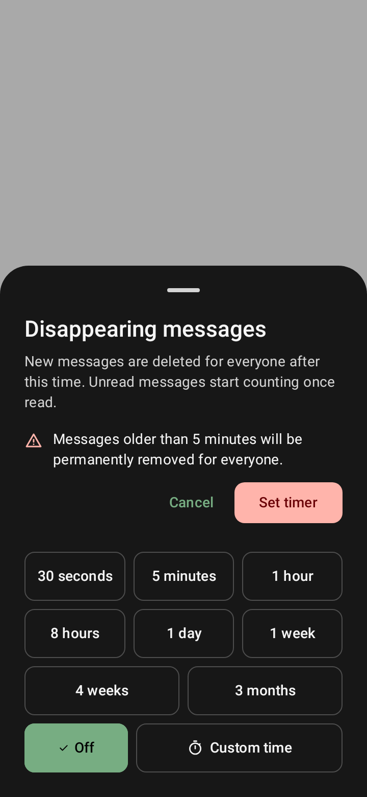 | The chat timer: a shorter timer confirms inside the sheet. |
| 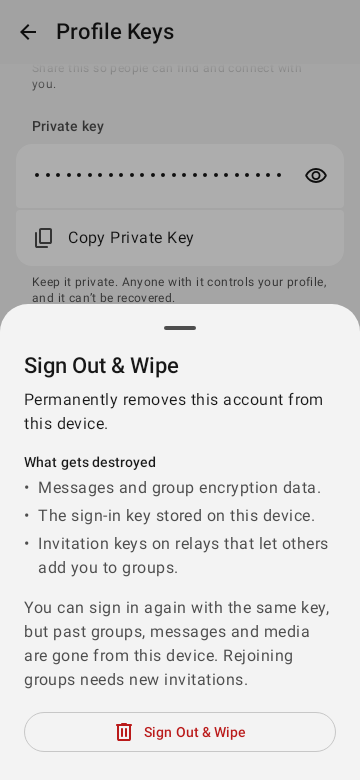 | The recorded exception: the wipe sheet explains exactly what is destroyed. |
| 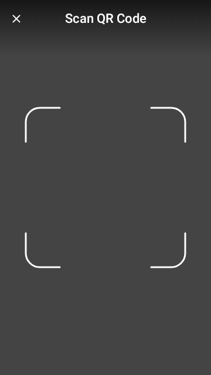 | The camera scanner is a full-screen task with Close, not a sheet with a handle. |

### Confirmation, Undo and the error colour (#4097)

Ask what the person would lose, and whether White Noise can put it back.

| Task | Material API | App component | Apply and dismiss |
| --- | --- | --- | --- |
| Irreversible loss (delete, clear a log, remove an emoji set, remove an account, wipe) | `AlertDialog` | `ConfirmDialog(destructive = true)` | Name what is affected and the action. The confirm button is in the error colour and Cancel is neutral and safe. |
| Delete a message | `AlertDialog` | `MessageDeleteDialog` | When both scopes exist, offer Delete for me, Delete for everyone and Cancel. Choosing a scope carries it out. |
| A reversible change that White Noise can restore | `Snackbar` with an Undo action, or inline Undo in a staged edit | `WhiteNoiseSnackbarHost`, the relay editor's Undo | The change runs at once. Undo restores the prior state. Downloading something again, or losing a discarded draft, is not Undo, so those confirm instead. |
| Leave an editor | — | Folder editor, photo editor | An unchanged editor just closes. Real edits ask with a named, error-coloured Discard. |

Every destructive command is in the error colour wherever it appears, in a
dialog or a menu row (`WhiteNoiseMenuItem(destructive = true)`): folder Discard,
Replace rules, photo editor Discard, account removal, Delete for me, and
groups-in-common Remove. Diagnostics › Clear and removing an emoji set confirm
first.

| Screenshot | What to look for |
| --- | --- |
| 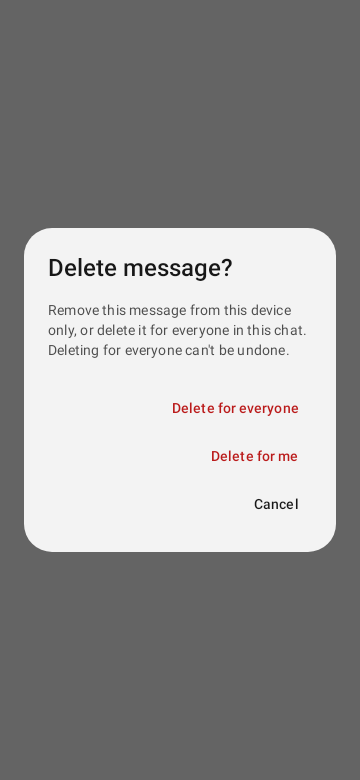 | The scope is named before acting, and Cancel keeps the message. |
| 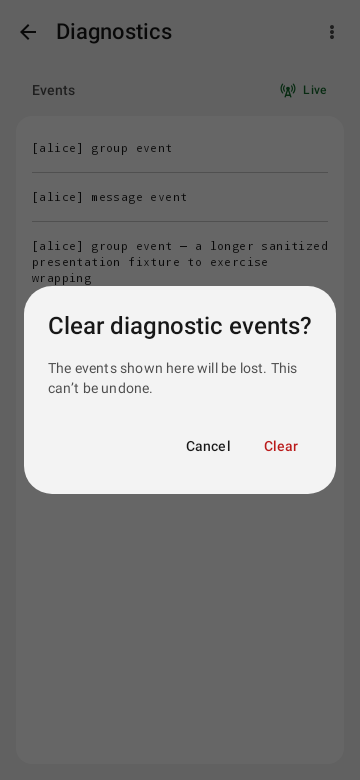 | Clearing the log says the entries will be lost. Clear is error-coloured. |
| 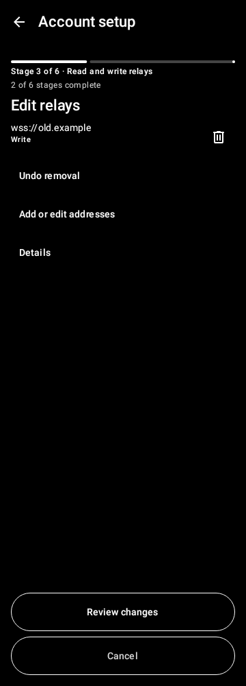 | A real reversible change: the removed relay can be restored before Review changes. |

### Item menus and toolbar menus (#4098)

| Task | Material API | App component | Apply and dismiss |
| --- | --- | --- | --- |
| Hold a message | Custom overlay | `FocusedMessageActions` | Recorded exception: the held message, its reaction rail and its actions stay together, so the content being acted on stays visible. |
| Hold a chat row or a search result | `DropdownMenuPopup`, anchored at the touch point | `WhiteNoiseAnchoredMenu` | One touch-anchored item menu near the press, inside the visible window. Its actions affect only that row or result. Chat rows and recent search results share it. |
| Tap a toolbar or row button | `DropdownMenu` anchored to its button | `WhiteNoiseDropdownMenu` with `WhiteNoiseMenuItem` | Miscellaneous screen actions sit behind the vertical ⋮. A specific action such as Share keeps its own icon when every option is a way to share. Within one menu, every row has an icon or none does. A value menu marks the current value (`selected`), as the read-aloud speed menu does. Destructive rows use the error colour. |

Feature code never calls `AnimatedDropdownMenu` or Material's `DropdownMenu`
directly. `UiBypassRatchetTest` counts the remaining callers and only lets the
count fall. `WhiteNoiseAnchoredMenu` stays as the item menu, so #4058 does not
retire it.

| Screenshot | What to look for |
| --- | --- |
| 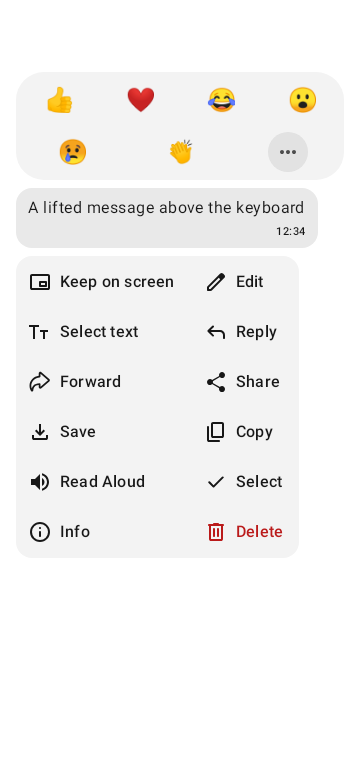 | The documented exception for messages. |
| 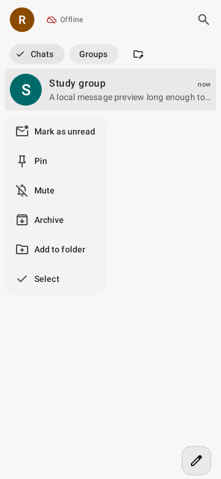 | The shared item menu: commands for the held chat only. |
| 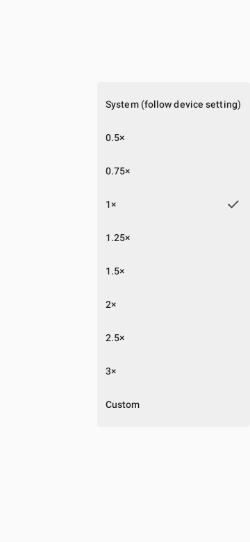 | A value menu on the shared dropdown: the current speed is checked. |
